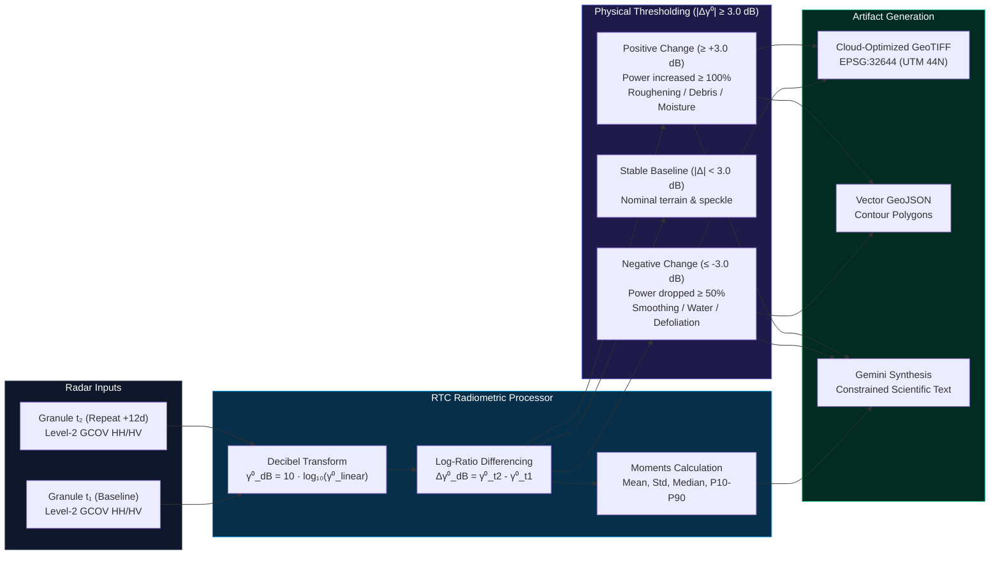
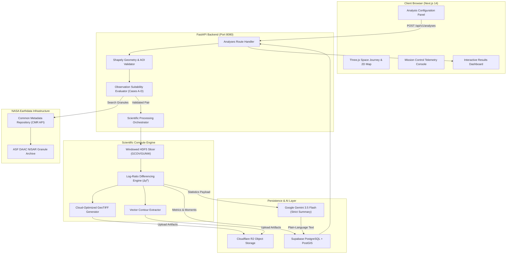

# 🛰️ Dancing with the SARs

[](https://www.spaceappschallenge.org/)
[](https://nisar.jpl.nasa.gov/)
[-black?style=for-the-badge&logo=next.js)](https://nextjs.org/)
[](https://threejs.org/)
[](https://fastapi.tiangolo.com/)
[](https://supabase.com/)
[](https://developers.cloudflare.com/r2/)
[](https://ai.google.dev/)

> An interactive, scientifically honest Earth observation and change-analysis platform powered by **NISAR (NASA-ISRO Synthetic Aperture Radar)**, focused on the dynamic Himalayan terrain of **Uttarakhand, India**.

---

## 📑 Table of Contents

1. [Project Overview & Core Philosophy](#1-project-overview--core-philosophy)
2. [The 7-Stage User Journey](#2-the-7-stage-user-journey)
3. [Verified Observation Sectors](#3-verified-observation-sectors)
4. [Physics of SAR & Mathematical Formulation](#4-physics-of-sar--mathematical-formulation)
5. [Orbital Mechanics & The 12-Day Repeat Cycle](#5-orbital-mechanics--the-12-day-repeat-cycle)
6. [System Architecture & Data Pipeline](#6-system-architecture--data-pipeline)
7. [Date Range Logic & Physical Constraints (Cases A, B, C, D)](#7-date-range-logic--physical-constraints)
8. [Role of Gemini: Constrained Translation Layer](#8-role-of-gemini-constrained-translation-layer)
9. [Database Schema (Supabase PostGIS) & Cloud Storage (R2)](#9-database-schema--cloud-storage)
10. [API Reference](#10-api-reference)
11. [Local Development Setup](#11-local-development-setup)
12. [Docker Deployment](#12-docker-deployment)
13. [Testing Suite](#13-testing-suite)
14. [Scientific Limitations & Honest Disclaimers](#14-scientific-limitations--honest-disclaimers)

---

## 1. Project Overview & Core Philosophy

**Dancing with the SARs** bridges the gap between raw, complex spaceborne Synthetic Aperture Radar (SAR) data and accessible geospatial exploration. Developed for the **NASA Space Apps Challenge**, it enables researchers, emergency planners, and curious explorers to analyze verified surface changes across Uttarakhand, India—a region subject to seismic shifts, active faulting, slope mass wasting, and environmental transformation.

### 🚫 The Absolute Anti-Hallucination Principle

Most consumer AI applications hallucinate disaster claims from general satellite imagery. **Dancing with the SARs is strictly engineered never to hallucinate:**

- ❌ **No Speculative Disaster Detection:** The system never declares a "landslide," "flood," or "deforestation" unless verified by ground truth or multi-sensor consensus.
- ❌ **No Fabricated Measurements:** The system never invents pixel counts, decibel shifts, confidence percentages, or acquisition dates.
- ✅ **Physical Provenance:** Every metric originates from calibrated L-band microwave backscatter power ($\gamma^0$) geocoded to UTM Zone 44N (EPSG:32644).
- ✅ **Scientifically Honest Language:**
  > *"Between Nov 15 and Dec 03, 2025, NISAR SAR observations over Nainital detected surface backscatter decrease of $\Delta\gamma^0 \le -3.0\text{ dB}$ across $19.01\text{ km}^2$ ($27.58\%$ of the analyzed area), consistent with surface smoothing, topsoil saturation, or seasonal canopy defoliation. Ground validation is required for definitive event confirmation."*

---

## 2. The 7-Stage User Journey

The application takes users on a continuous, cinematic journey from deep space down to high-resolution Himalayan radar pixels:


1. **Space Landing (`space`):** Procedural Three.js cosmic starfield with volumetric nebula particles and ambient cosmic drone audio (Web Audio API).
2. **Solar System Navigation (`solar_system`):** 3D interactive planetary bodies with real-time orbital rotation. Clicking any planet focuses on Earth.
3. **Earth Focus HUD (`earth`):** Photorealistic Earth sphere with custom atmospheric halo shaders and target acquisition vector centered on India.
4. **India National Stage (`india`):** Responsive national SVG vector boundary highlighting Uttarakhand within the Northern Himalayan arc.
5. **Uttarakhand Command Center (`uttarakhand`):**
   - **Ultra-HD Topographic Relief:** $2940 \times 2460$ native raster resolution enhanced with Lanczos super-sampling and multi-pass unsharp masking to guarantee zero blurring upon camera zoom.
   - **36 Verified Locations:** Pre-indexed cities and valleys (Joshimath, Nainital, Kedarnath, Karnaprayag, etc.) with elevation and coordinates.
   - **Cinematic Targeting Reticle:** Smooth camera glide and target crosshair upon location selection.
   - **Topographic Vectors:** Elevation contours ($1,000\text{m}$, $2,500\text{m}$, $4,500\text{m}$, $6,000\text{m}$) and Himalayan river network (Ganga, Alaknanda, Bhagirathi, Mandakini, Yamuna, Kali, Kosi).
6. **Active Telemetry Console (`analyzing`):** Dual-column Mission Control console featuring a real-time rotating radar sweep needle, live Doppler oscilloscope waveform, milestone progress indicator, and satellite orbital parameters.
7. **Result Dashboard (`result`):**
   - **Interactive Geospatial Change Map:** Toggleable radar difference vectors and bounding AOI geometry.
   - **Probability Density Histograms:** Gaussian-modeled backscatter distribution with calibrated $\pm 3.0\text{ dB}$ threshold zones.
   - **Area Distribution Split:** Negative change, positive change, and stable baseline area breakdown.
   - **AI Scientific Synthesis:** Constrained Gemini summary with explicit physical limitations.

---

## 3. Verified Observation Sectors

The platform supports two verified observation sectors tailored to NISAR L-band polarimetry:

```
┌──────────────────────────────────────────────┬──────────────────────────────────────────────┐
│  🏔️ Terrain & Surface Change                 │  🌲 Forest & Canopy Structure                │
├──────────────────────────────────────────────┼──────────────────────────────────────────────┤
│  Code: GCOV-RTC                              │  Code: BIOMASS-SAR                           │
│  Product: NISAR Level-2 GCOV (HH/HV)         │  Product: NISAR Level-2 GCOV (HV Cross-Pol)  │
│  Method: RTC Log-Ratio (Δγ⁰ in dB)           │  Method: Cross-Pol Volume Scattering Ratio   │
│  Physics: Physical roughness, slope erosion, │  Physics: Microwave canopy penetration,      │
│  mass wasting, rockfall, and debris shift.   │  defoliation, logging, and biomass changes.  │
└──────────────────────────────────────────────┴──────────────────────────────────────────────┘
```

---

## 4. Physics of SAR & Mathematical Formulation

Synthetic Aperture Radar (SAR) is an active sensor operating in the microwave spectrum (L-band: $\approx 24\text{ cm}$ wavelength, $1.25\text{ GHz}$). Unlike optical cameras, it operates independently of clouds, haze, or daylight.

### 1. Linear Backscatter to Decibels (dB)
Radar backscatter coefficient ($\gamma^0$, terrain-corrected backscattering coefficient) is converted to a logarithmic scale:
$$\gamma^0_{\text{dB}} = 10 \cdot \log_{10}(\gamma^0_{\text{linear}})$$

### 2. Temporal Log-Ratio (Change Metric)
Between two repeat passes acquired on Day 1 ($t_1$) and Day 2 ($t_2$) under identical flight geometry:
$$\Delta\gamma^0_{\text{dB}} = \gamma^0_{t_2, \text{dB}} - \gamma^0_{t_1, \text{dB}} = 10 \cdot \log_{10}\left(\frac{\gamma^0_{t_2, \text{linear}}}{\gamma^0_{t_1, \text{linear}}}\right)$$

### 3. The Calibrated $\pm 3.0\text{ dB}$ Threshold
The radiometric noise floor and calibration stability of NISAR L-band SAR is $\approx \pm 0.5\text{ to }1.0\text{ dB}$. A threshold of $|\Delta\gamma^0| \ge 3.0\text{ dB}$ corresponds to a **doubling ($2\times$) or halving ($0.5\times$) of returned power**:

| Classification | Condition | Physical Meaning |
| :--- | :--- | :--- |
| **Negative Change** | $\Delta\gamma^0 \le -3.0\text{ dB}$ | **Radar power dropped by $\ge 50\%$**: Smooth surface water accumulation (specular deflection away from satellite), mud/silt wash, or forest canopy defoliation. |
| **Stable Surface** | $-3.0\text{ dB} < \Delta\gamma^0 < +3.0\text{ dB}$ | **Baseline nominal fluctuation**: Normal seasonal variability, stable bedrock, and sensor speckle. |
| **Positive Change** | $\Delta\gamma^0 \ge +3.0\text{ dB}$ | **Radar power increased by $\ge 100\%$**: Surface roughening, gravel and boulder deposition, structural debris, or dielectric moisture rise. |

### 4. Pixel-to-Area Scaling
Each Level-2 GCOV pixel covers $80.4\text{m} \times 80.4\text{m} = 6,464.16\text{ m}^2 = 0.006464\text{ km}^2$.  
$$\text{Area}_{\text{change}} (\text{km}^2) = N_{\text{significant pixels}} \times 0.006464\text{ km}^2$$

### 5. Radiometric Compute & Thresholding Pipeline



---

## 5. Orbital Mechanics & The 12-Day Repeat Cycle

NISAR circles the Earth in a sun-synchronous **Low Earth Orbit (LEO)** at an altitude of **$747\text{ km}$**, traveling at **$27,000\text{ km/h}$** ($7.5\text{ km/s}$):

### Why Date Windows $< 12$ Days Cannot Be Compared
1. **The 12-Day Orbital Ground Track:** It takes the satellite **exactly 12 days (173 orbital revolutions)** to retrace the exact same flight path (orbital tube) over Uttarakhand.
2. **Identical Look Geometry Requirement:** Comparing radar images taken from different tracks (e.g., Track 106 vs. Track 179) or opposing directions (Ascending looking West vs. Descending looking East) causes **Aspect-Angle Geometric Decorrelation**. In steep Himalayan terrain, mountain shadows and radar layover invert, producing false change signals across $90\%$ of the image.
3. **The Repeat-Pass Pair:** Over Uttarakhand Track 106, Frame 73/74:
   - Pass 1 (Baseline): November 17, 2025
   - Pass 2 (Repeat): November 29, 2025
   - *If a user selects Nov 15 to Nov 27 (12 days total, but only 10 days after Pass 1), Pass 2 has not occurred yet. Only 1 observation exists, triggering `insufficient_data`.*

### Future Date Physical Constraints
Satellite SAR sensors record microwave backscatter during real-time physical flyovers. Observations **cannot exist for future dates**. Selecting an observation date beyond today triggers an immediate `INVALID DATA: FUTURE ACQUISITION DATE` error.

---

## 6. System Architecture & Data Pipeline



---

## 7. Date Range Logic & Physical Constraints

Every request is evaluated through a strict orbital and physical decision tree:

```mermaid
flowchart TD
    Start(["User Submits Analysis Request<br/>(AOI, Dates, Sector)"]) --> ValDate{"Is Acquisition Date<br/>in the Future?"}
    
    ValDate -->|Yes (Date > Today)| InvFuture["❌ INVALID DATA Error<br/>Future acquisitions violate physical causality"]
    ValDate -->|No (Date ≤ Today)| QueryCMR["Query NASA CMR API<br/>Spatial Intersect AOI & Date Window"]
    
    QueryCMR --> ObsCount{"Total NISAR<br/>Granules Found?"}
    
    ObsCount -->|0 Granules| CaseC["Case C: Zero Observations<br/>No satellite passes during window<br/>➔ Status: insufficient_data"]
    ObsCount -->|1 Granule| CaseB["Case B: Single Observation<br/>12-day repeat orbit incomplete<br/>➔ Status: insufficient_data"]
    ObsCount -->|≥ 2 Granules| GeomCheck{"Matching Orbital Track &<br/>Flight Direction (Asc/Desc)?"}
    
    GeomCheck -->|No| CaseD["Case D: Geometry Mismatch<br/>Inverted terrain layover & shadow<br/>➔ Status: insufficient_data"]
    GeomCheck -->|Yes| CaseA["Case A: Valid Repeat-Pass Pair<br/>Same relative track (e.g. 106, Frame 74)<br/>➔ Proceed to Scientific Compute"]
    
    CaseA --> Process["Windowed HDF5 Slicing ➔ RTC Log-Ratio (Δγ⁰)<br/>±3.0 dB Threshold ➔ GeoTIFF & Gemini Synthesis<br/>➔ Status: completed"]

    style InvFuture fill:#450a0a,stroke:#f87171,color:#fff
    style CaseC fill:#3b0764,stroke:#c084fc,color:#fff
    style CaseB fill:#431407,stroke:#fb923c,color:#fff
    style CaseD fill:#3730a3,stroke:#818cf8,color:#fff
    style CaseA fill:#064e3b,stroke:#34d399,color:#fff
    style Process fill:#0f172a,stroke:#38bdf8,stroke-width:2px,color:#fff
```

### Deterministic Scientific Cases Defined:

* **Case A — Sufficient Repeat Observations:** At least 2 observations exist on a matching orbital track, frame, and flight direction. The backend computes the differential backscatter matrix and returns full results.
* **Case B — Single Observation Available:** Exactly 1 observation exists in the window. Temporal differencing is mathematically impossible. Returns `insufficient_data` with a suggestion to expand the date range.
* **Case C — Zero Observations Found:** No satellite passes occurred over the AOI in the requested window. Returns `insufficient_data`.
* **Case D — Geometry Mismatch:** Observations exist but possess conflicting orbital tracks (e.g., Track 106 and Track 179) or look directions (Ascending vs. Descending). Rather than returning false change artifacts, the system safely reports incompatible geometry.

---

## 8. Role of Gemini: Constrained Translation Layer

Google Gemini (via the `google-genai` SDK) is strictly restricted to a **plain-language translation role**:

- ❌ **Cannot compute** numbers, thresholds, or pixel counts.
- ❌ **Cannot inspect** raw binary HDF5 datasets.
- ❌ **Cannot assert** unconfirmed disasters (landslides, floods, forest destruction).
- ✅ **Sector-Tailored Context:** Synthesizes precalculated metrics based on the requested sector (volume scattering for forests, specular deflection for wetlands, surface roughness for terrain).
- ✅ **Deterministic Fallback:** If the Gemini API is offline or unconfigured, the system automatically uses a deterministic, scientifically safe fallback template.

---

## 9. Database Schema & Cloud Storage

### Supabase PostgreSQL + PostGIS (`backend/scripts/setup_supabase_schema.sql`)
1. **`analyses` table:** Records analysis requests, target districts, AOI bounding polygons, temporal windows, and execution status (`pending`, `searching`, `processing`, `completed`, `insufficient_data`).
2. **`observations` table:** Discovered NISAR granules, orbital tracks, frames, look directions, and suitability flags.
3. **`analysis_results` table:** Quantified change area ($\text{km}^2$), percentage, statistical moments (mean, std, median, percentiles), R2 artifact URLs, and Gemini explanation.

### Cloudflare R2 Object Storage
- Stores processed scientific deliverables (`nisar_change_diff.tif` and `nisar_change_vectors.geojson`).
- Raw multi-gigabyte HDF5 archives are processed via windowed streaming and are never needlessly persisted.

---

## 10. API Reference

### Health & Diagnostics
* `GET /health` — Service health, storage provider status, Supabase connection, and CMR endpoint diagnostics.

### Geographic Reference
* `GET /api/v1/regions` — Supported regions (Uttarakhand).
* `GET /api/v1/regions/uttarakhand/districts` — All 13 Uttarakhand districts with centroids and bounding boxes.
* `GET /api/v1/regions/uttarakhand/districts/{district_id}` — Detailed boundaries and orbital parameters for a specific district.

### Satellite Observations
* `POST /api/v1/observations/search` — Search NASA CMR for NISAR granules intersecting a bounding box or district.

### Change Analysis Execution
* `POST /api/v1/analyses` — Create and run analysis (`async_exec=false` for synchronous execution, `async_exec=true` for background task).
* `GET /api/v1/analyses/{analysis_id}` — Retrieve analysis status, metrics, and spatial artifact URLs.

---

## 11. Local Development Setup

### Prerequisites
- **Node.js** (v18.17+ or v20+)
- **Python** (v3.10, v3.11, or v3.12)
- **Git**

---

### Step 1: Backend Setup (FastAPI)

```bash
# 1. Open terminal in project root
cd e:\Hackathon_BIAS

# 2. Activate virtual environment
# Windows PowerShell:
.\venv\Scripts\Activate.ps1
# Linux / macOS:
source venv/bin/activate

# 3. Install Python dependencies
pip install -r requirements.txt

# 4. Configure environment variables
# Copy .env.example to .env and configure Supabase / Cloudflare R2 / Gemini
cp .env.example backend/.env

# 5. Start the FastAPI server
uvicorn backend.app.main:app --reload --port 8080
```

*Interactive API Swagger documentation is available at **http://localhost:8080/docs**.*

---

### Step 2: Frontend Setup (Next.js 14)

```bash
# 1. Open a new terminal in the frontend directory
cd e:\Hackathon_BIAS\frontend

# 2. Install dependencies
npm install

# 3. Verify environment configuration (.env.local)
# NEXT_PUBLIC_API_BASE_URL=http://localhost:8080
# NEXT_PUBLIC_USE_MOCK_DATA=false

# 4. Start the Next.js development server on port 3002
npm run dev -- -p 3002
```

*Access the application in your browser at **http://localhost:3002**.*

---

## 12. Docker Deployment

The platform is containerized for seamless cloud deployment:

```bash
# Build the Docker container
docker build -t dancing-with-the-sars-backend .

# Run the container mapping port 8080
docker run -p 8080:8080 --env-file backend/.env dancing-with-the-sars-backend
```

---

## 13. Testing Suite

The backend includes a comprehensive automated test suite covering geometry validation, temporal pairing, SAR log-ratio calculation, and API contract compliance:

```bash
# Run pytest with verbose output
pytest backend/tests/ -v
```

---

## 14. Scientific Limitations & Honest Disclaimers

1. **Physical Scattering Mechanism:** Satellite SAR backscatter measures surface roughness, geometric orientation, and dielectric permittivity (moisture). It does not directly observe chemical composition, landownership, or legal boundaries.
2. **Himalayan Topographic Shadowing:** Although Radiometric Terrain Correction (RTC) normalizes slope illumination angles, extremely steep northern Himalayan escarpments may experience radar shadow or layover where no valid microwave pulse returns.
3. **Attribution and Validation:** Measurable changes in radar backscatter indicate physical surface alterations during the observation window. Ground confirmation or auxiliary multi-spectral validation is required before asserting specific disaster attribution.

---

<p align="center">
  <b>Dancing with the SARs</b> — Built for the <b>NASA Space Apps Challenge</b>. Open Science. Zero Hallucination.
</p>
